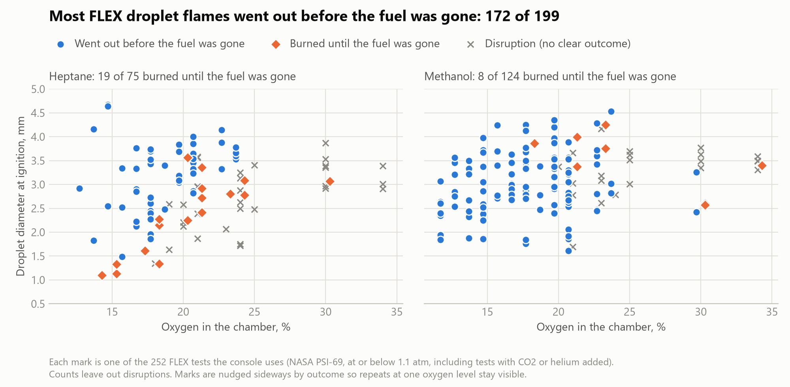

# Flame in Freefall crew fire console

Team Second Toe, 2026 NASA Space Apps Challenge (Universal Event).
Challenge: Flame in Freefall: SI-Powered Fire Safety Insights from Microgravity Combustion Data.

## What it is

A dashboard that summarizes, ranks and interprets NASA's microgravity combustion
investigations for fire safety, built to be driven with a gamepad on a handheld. Its
AI runs on the team's own machines, not in the cloud, and needs no internet.

Try it in a browser: https://jeerun.github.io/flame-in-freefall/ (everything except
Ember, the AI, which needs the team's PC).

- **NASA research** (the home page) summarizes the 24 combustion investigations in
  NASA's PSI database and ranks them for the question you pick: prevention,
  detection, suppression, or cabin air (the oxygen-rich, low-pressure air planned for
  the Moon Base). The list can be switched to an orbit view: the question sits in the
  middle and the investigations circle it, the most relevant nearest the centre.
- **Oxygen map** (Y on the research page) puts the tests of seven investigations on
  one oxygen axis, read from nine of NASA's own test tables. It has three levels of
  detail: the range each investigation covered, every test as a dot, and every test
  against pressure with the Moon Base air from the challenge brief marked. Its
  headline is counted from the tables: of 746 microgravity tests that record both
  the oxygen and the pressure of the surrounding gas, 20 were run in Moon Base air.
- **Flame console** goes deep on one investigation, the Flame Extinguishment
  Experiment (FLEX). Set the fuel, oxygen, pressure, carbon dioxide, helium and
  droplet size, and it shows the chance a droplet flame burns until the fuel is gone,
  the burning rate, and an explanation that opens with the prediction, the evidence
  from real tests and the limits, with the reasoning and the closest real NASA tests
  one press away. Any set of settings can be saved as a baseline and compared side by
  side with a changed set, with the warnings of both kept in view. One
  button switches the cabin air between Earth-like air, the Moon Base case from the
  challenge brief, and a Mars base (same air, labelled as an assumption), and the
  background becomes the Earth, the Moon or Mars. Under the reading is a star map:
  every star is a real FLEX test, its shape and colour say how it ended, its size how
  fast it burned. Point at a star with the right stick to read it, replay it from
  NASA's measurements, or move the settings onto it. The map zooms to the whole
  screen, with a grid, the test numbers and the model's 25, 50 and 75 % lines.
  **Ignite** plays one run of the model as a picture drawn like FLEX footage. The
  page warns, with a banner, a sound and a buzz, when the settings leave what the
  experiments actually tested.
- **Fire drill** is a ten-round game. It shows the settings of a real FLEX test and
  you guess how it ended. It then replays the test, shows NASA's recorded result and
  keeps score, you against the model, with a streak, a rank and a best score.
- **Ember**, the on-board AI, is on every page when the dashboard is served by
  `server/serve.py`. It is a language model running on the team's PC (RTX 5080), or
  a smaller one on the handheld itself. Left on "Auto" it uses the PC while the PC
  answers and the handheld when it does not, and says so. It answers from the NASA
  PSI records, the counts from NASA's test tables and the numbers on screen, cites
  the PSI ids it used, and can read its answers aloud. Nothing leaves the local
  network.
- **The real tests go with you.** One button downloads the 252 FLEX tests in use,
  with the model's prediction beside each, as a CSV file. Another sends that file to
  the computer that serves the dashboard, so it is not left on the handheld.

Why a gamepad: a crew member may be wearing gloves. Every function can be reached
from the sticks and buttons, the left stick slides a setting across its whole range
in about a second, and warnings come as sound and vibration as well as text. We
have not tried it with gloves, or on the real handheld yet.

The console numbers come from two small models trained on FLEX (PSI-69). The
research summaries and ranks were written by an AI model from the PSI records and
are labelled as such. It is a study and planning tool, not a crew procedure.

## Status

Working on real data (Nov 15, 2026).

- Done: data cleaned, models trained and reviewed, all pages and the local AI built
  and checked on the team's PC in a desktop browser, with keyboard and a simulated
  gamepad. The two-machine set-up (PC plus handheld) was checked with two copies of
  the server on the one PC. Ember's answers to 18 fixed questions are in
  `docs/ember-check.md`, with automatic checks but no human check yet.
- Not done yet: trying it on the real Lenovo Legion Go (alone, over Wi-Fi to the PC,
  and with its own small model), the demo video, the submission form.

## Run it

There are three ways.

**In a browser, nothing to install.** https://jeerun.github.io/flame-in-freefall/
It is the `console/` folder, published with
`git subtree push --prefix console origin gh-pages`. No Ember there.

**Without the AI, fully offline.** Open `console/index.html` in Edge or Chrome and
press F11. No install, no internet. Keep `model.js`, `research.js` and `tables.js`
next to it. Without `model.js` the page falls back to made-up numbers and shows a
yellow "Mock numbers" banner. Without `research.js` the NASA research page is
hidden, and without `tables.js` the Oxygen map is.

**With the AI, served from the team's PC.** One-time setup on the PC with the GPU:
install Ollama from https://ollama.com and pull the model.

    ollama pull gemma4:12b

Then double-click `Start dashboard.bat` in the repo folder on that PC. It opens the
dashboard in the browser and prints the address to open on the Legion Go. The same
thing by hand, from the repo root:

    py server/serve.py           (this PC only: open http://localhost:8000)
    py server/serve.py --lan     (also the Legion Go on the same Wi-Fi)

The first time, Windows asks whether to let Python through the firewall: tick the
kind of network the PC is on (Private, Public, or both) and allow it. When the
handheld gets through, the PC window prints "New device connected". Step by step,
with what to do when it does not connect: `docs/legion-go-setup.md`. The script
needs only the Python standard library. If the PC is
off or out of reach, open the file directly as above: everything except Ember still
works.

**Two machines, each with its own model** (not yet tried on the real handheld). On
the Legion Go download this repo as a ZIP, double-click `Setup Legion Go.bat` once
(it installs Python and Ollama with winget and downloads the 4.3 GB model
`gemma4:e2b`), then double-click `Start on Legion Go.bat`. It asks once for the
address the PC printed. Ember then shows where it is thinking, X switches between
the machines, and if the PC stops answering the handheld answers by itself and a
banner says so. Away from the Wi-Fi the same works over a private network such as
Tailscale; do not use a public tunnel.

**Where the sent file goes.** "Send to base" stores the CSV in the folder `exports/`
on the computer that runs the server (and passes it on to the PC when the handheld
runs its own server). To share it with other people, point that folder at one a
sync app already shares, such as Google Drive or OneDrive: write the folder on the
first line of a file named `exports-folder.txt` next to `Start dashboard.bat`, or
start with `--exports "<folder>"`. The server never signs in to anything; the file
simply waits in the folder until that computer has internet.

## Controls

Press A on the start screen. RB and LB turn the page. The Menu button opens Ember,
who answers the first question straight away; Up/Down pick another, A asks it,
B closes.

| Where | Gamepad | Keyboard |
|---|---|---|
| NASA research | Left/Right change the question. Up/Down move through the ranked list. X switches between the list and the orbit view. In the orbit view the right stick points at an investigation. Y (or View) opens the Oxygen map. | Arrows, X, O |
| Oxygen map | Up/Down pick an investigation. Left/Right or X change the level of detail. B or Y closes. | Arrows, 1 to 3, X, Esc |
| Flame console | Up/Down pick a setting. The left stick slides it: a light push creeps, a full push sweeps. The d-pad moves it one step. A explain, B close, X cabin air (Earth, Moon Base, Mars base), Y reset. Right stick picks a star, RT replays that test, pressing the right stick moves the settings onto it. LT Ignite. View zooms the star map. Pressing the left stick sends the tests to the base computer. | Arrows, Enter, Esc, X, R, `[` and `]` pick a star, P replay, G go there, I Ignite, Z zoom the map, D download the tests, S send or share them |
| Explanation (A) | Up/Down or the right stick scroll it. X opens "Why this prediction?", Y opens "Test details and sources". LT saves the settings as baseline A and opens the comparison. B closes. | W, T, H, Esc |
| Comparison | The settings still change as usual and update B live. LT makes B the new baseline. The right stick scrolls. B closes. | H save or replace the baseline, C open or close, Esc |
| Zoomed star map | Up/Down or the right stick pick a star. Left/Right or X change the level of detail. RT replay, right-stick press go there, B or View closes. | Arrows, 1 to 3, X, P, G, Esc |
| Ignite | A or LT runs it again, B closes. | Enter, Esc |
| Fire drill | Left "went out first", Right "burned all its fuel", A next test, Y new game, B home. | Arrows, Enter, R, Esc |
| Ember | Up/Down pick a question, A asks, X switches the machine it thinks on, Y voice on or off, B closes. | Arrows, Enter, X, V, Esc |
| Everywhere | RB/LB pages, Menu opens Ember. | 1, 2, 3 pages, `/` Ember, M sound on or off |
| Mouse, trackpad, or the Legion Go's right controller in FPS mode | Point at a star to pick it, click to replay it, right-click to move the settings onto it. The wheel turns the selected setting, walks through the stars over the map, and moves through the lists. | |

The Legion Go's six extra buttons can be set to these keys in Legion Space; a
suggested layout is in `docs/legion-go-setup.md`.

Banners with a sound and a buzz appear when: the settings leave what NASA tested
(alarm and a strong buzz) or come back inside; the fire risk turns high; real tests
nearby disagree with the model; Ember loses or regains the big machine; a file is
saved or sent. The flame picture also turns into a question mark outside the tested
range. Touch works too. Sound, voice and rumble depend on the browser and the
device: if one is missing, nothing else breaks.

## Rebuild

Needs Python with pandas, numpy and scikit-learn. From the repo root:

    python data/clean/build_clean.py
    python model/train.py
    python data/clean/build_research.py
    python data/clean/build_tables.py

The first builds `data/clean/flex_clean.csv` from the raw table. The second trains
both models, writes `model/metrics.json` and exports `console/model.js`. The results
are seeded, so a re-run gives the same numbers. The third joins the PSI records with
the notes in `data/clean/research_notes.json` and writes `console/research.js`. The
fourth reads the oxygen and pressure of each test from the PSI test tables and
writes `console/tables.js` and the counts Ember is given. It needs no extra packages.

`python model/science_audit.py` repeats the independent audit, and
`python -m unittest tests.test_science_audit` runs its tests.
`python model/check_parity.py` repeats the page-versus-Python check (needs Node.js).
`node tests/test_console_features.cjs` tests the explanation summary and the baseline
comparison against the page's own code.

`python data/clean/fetch_psi_tables.py` downloads the PSI test tables again (it
never overwrites a file that is already there). With the server running,
`python server/ember_check.py` asks Ember the 18 fixed questions again and rewrites
`docs/ember-check.md`.

## Data

All from NASA Physical Sciences Informatics (PSI), the source named by the challenge.

- PSI-69, Flame Extinguishment Experiment (FLEX), version 5, Experimental Table.
  DOI 10.60555/mbq8-0451, licence CC0-1.0.
  https://psi.nasa.gov/physci/repo/data/investigations/PSI-69
  Read from the table shown on that page on Nov 14, 2026: 274 droplet combustion
  tests (methanol 157, heptane 117). 252 are used: pressure at or below 1.1 atm with
  a known droplet size.
- The PSI records of the combustion investigations (title, project type, hardware,
  objectives, approach), from the repository's search for "combustion" on
  Nov 14, 2026: 26 records, 24 of them combustion science.
  https://psi.nasa.gov/physci/repo/search?q=combustion
- The Experimental Table of every one of those investigations that has one: 25 files,
  downloaded unchanged from PSI on Nov 14, 2026, listed with version, DOI, licence
  and SHA-256 in `data/raw/psi_tables/MANIFEST.json`. Nine of them give an oxygen
  value for each test and feed the Oxygen map: FLEX, CFI, CFI-G (two tables), Flame
  Design (two tables), BASS-II, Saffire-I and Saffire-II.

Details in `data/raw/README.md` and `data/clean/README.md`. Every source, and where
each sentence on screen comes from, is in `docs/sources.md`.

The chart is drawn from the cleaned table by `python docs/make_chart.py` (needs matplotlib).

## How good is the model

Measured on tests held out of training (5-fold cross-validation, repeated 20 times):

| Model | Tests | Result |
|---|---|---|
| Does the flame go out before the fuel is gone (logistic regression) | 199 | AUC 0.81. Accuracy 0.887, against 0.864 for always answering "goes out". |
| Burning rate in mm²/s (linear regression) | 252 | Mean absolute error 0.048, R² 0.71. The values spread about 0.14. |

Known limits: the outcome model is much weaker for methanol than for heptane (only
8 of 124 methanol tests burned to completion); pressure sits at only two levels;
"goes out" means the visible flame only. More in `docs/submission.md`.

Two independent checks by a teammate:

- `docs/scientific-validation.md` (`model/science_audit.py`): a separately fitted
  model on the same 199 tests, five-fold cross-validation over five seeds. Mean
  accuracy 88.8 %, balanced accuracy 61.4 %. Read as a yes or no at 50 %, it finds on
  average only 23.7 % of the tests that burned to completion (heptane 19 %, methanol
  35 %). So a low percentage on the console means "less likely", not "it will go
  out". Re-run on the team's PC: same results, 5 of 5 tests pass.
- `docs/model-parity.md` (`model/check_parity.py`): runs the page's own prediction
  code in Node against the Python model on 820 inputs and finds the same numbers to
  within rounding. Its three tests also pass on the team's PC, using the Node.js that
  ships with Playwright.

## Folders, and who owns each

| Folder | Owner (role) | What goes here |
|---|---|---|
| `data/raw/` | 1 Data | Files exactly as downloaded from NASA PSI. Never edit these. |
| `data/clean/` | 1 Data | One tidy CSV built from the raw files, plus notes on each column. Also the research notes and the script that writes `console/research.js`. |
| `model/` | 2 Model | Training script. It writes `console/model.js`. Also the independent audit (`science_audit.py`, results in `audit_v2_1/`) and the parity check (`check_parity.py`). |
| `tests/` | 2 Model | Tests for the audit and the parity check. |
| `console/` | 3 Console | `index.html`, the page that runs on the Legion Go, with `model.js`, `research.js` and `tables.js`. |
| `server/` | 3 Console | `serve.py`: serves the dashboard on the local network, passes questions for Ember to the language model, and keeps the sent CSV file. `ember_check.py`: asks Ember a fixed list of questions for checking. |
| `docs/sources.md` | 4 Science | Every NASA dataset and source we use. |
| `docs/submission.md` | 5 Submission | Draft text for the submission form. |
| `docs/demo-script.md`, `docs/checklist.md`, `docs/legion-go-setup.md` | 5 Submission | Demo video script, the pre-submission checklist, and how to set up the Legion Go. |
| `docs/ember-check.md` | 4 Science | Ember's answers to 18 fixed questions, waiting for a human verdict on each. |

One owner per folder. If you need a change in someone else's folder, ask them.

## Working together

1. Pull before you start. Push small changes often.
2. Stay in your own folder.
3. Not using git? On github.com open your folder, then Add file > Upload files.
4. Stuck for more than 30 minutes? Say so in the group chat.

## Use of AI

Inside the product, three kinds of AI, each labelled on screen:

- Ember ("Ask Ember"): Gemma 4 (12B, an open model from Google) run locally with Ollama on
  the team's RTX 5080 PC, or a smaller Gemma 4 on the handheld. `server/serve.py`
  gives it the NASA PSI text for the investigations closest to the question, the
  counts this project made from NASA's test tables, or the reading on screen, and
  tells it to answer only from that and to cite PSI ids. Its answers are written on
  the spot and can be wrong: `docs/ember-check.md` holds 18 of them for checking.
  Nothing is sent to the internet.
- The summaries, "why it matters" lines and 0 to 3 relevance scores on the NASA
  research page were written ahead of time by Claude (Anthropic) from each
  investigation's PSI record (`data/clean/research_notes.json`). Titles, project type
  and hardware are copied from PSI unchanged.
- The predictions on the Flame console page come from plain logistic and linear
  regression, which is machine learning but not generative AI.

While building it we used Claude (Anthropic), an AI assistant: planning, writing the
dashboard code, the server and the data-cleaning and training scripts, reviewing and
re-running them, reading the PSI-69 table and the challenge page, finding sources,
and drafting the documentation.

The summary-first explanation panel and the baseline comparison were written by a
team member with OpenAI ChatGPT/Codex, then reviewed, fitted to the screen, given a
controller path and tested with Claude. The training code, the model coefficients and
the NASA data were not changed by it.

A teammate contributed the independent audit and the parity check (`model/science_audit.py`,
`model/check_parity.py` and their documents). We could not confirm whether AI tools
helped write them, so treat that code and text as possibly AI-assisted. The audit was
re-run on the team's PC and reproduced exactly.

No AI-generated images, video or audio are used, and no data value was generated or
changed by AI. Keep this section current: the submission form asks where and how AI
was used.
