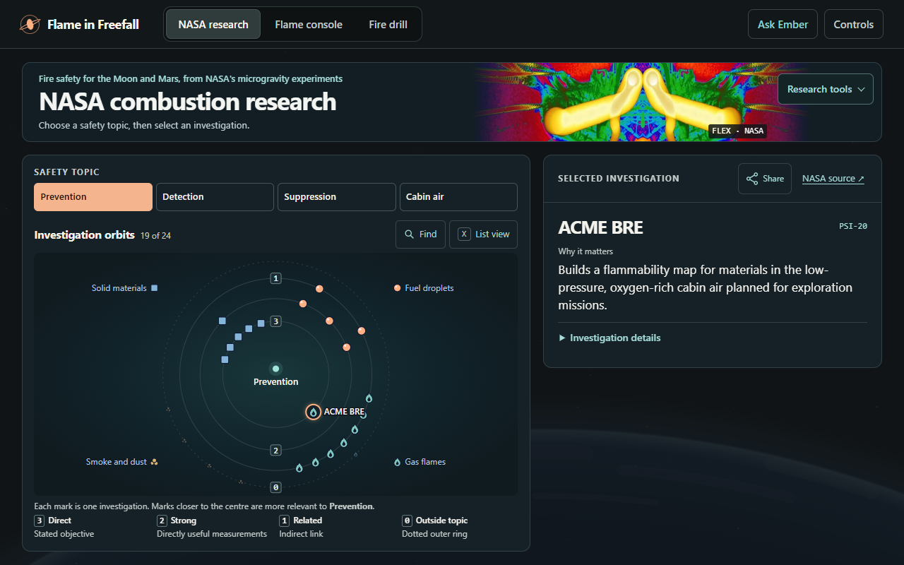

# Flame in Freefall crew fire console

Team Second Toe, 2026 NASA Space Apps Challenge (Universal Event).
Challenge: Flame in Freefall: SI-Powered Fire Safety Insights from Microgravity Combustion Data.

## What it is

A dashboard that summarizes, ranks and interprets NASA's microgravity combustion
investigations for fire safety, built to be driven with a gamepad on a handheld. Its
documented Ember setup uses a downloaded Gemma model on the team's hardware.

Try it in a browser: the [published dashboard](https://jeerun.github.io/flame-in-freefall/),
or open `console/index.html` from a checkout.
[Watch the short desktop demo](docs/crew-console-demo.mp4).

- **NASA research** (the home page) summarizes the 24 combustion investigations in
  NASA's PSI database and ranks them for the question you pick: prevention,
  detection, suppression, or cabin air (the oxygen-rich, low-pressure air planned for
  the Moon Base). The list can be switched to an orbit view: the question sits in the
  middle and the investigations circle it, the most relevant nearest the centre.
- **Oxygen map** (Y on the research page) puts the tests of seven investigations on
  one oxygen axis, read from nine of NASA's own test tables. It has three levels of
  detail: the range each investigation covered, every test as a dot, and every test
  against pressure with the Moon Base air from the challenge brief marked. Its
  headline counts published rows. Of 746 rows with ambient oxygen and pressure,
  20 CFI-G rows meet the brief’s thresholds. The CFI source repeats eight rows,
  and FLEX has no flight/ground label per row. Select an investigation to see its
  measurements across all three views. [Mobile pressure chart](docs/oxygen-map-phone.png)
- **Earth or orbit?** Pick which environment gave the longer burn for a Saffire-II
  material, then reveal the measured lengths side by side (Research, LT or E).
- **Read the sensors.** See the initial and final oxygen readings from BASS-II,
  then reveal how CO and CO₂ changed in the same test (Research, RT or N).
- **[Ember evidence lab](console/ember-lab.html).** On Research, select **Open evidence lab**
  (L or left-stick click). In **FLEX footage**, compare two candidate frames with the original NASA
  movie and select a timestamp to seek there. In **Ask the table**, try “Which tests recorded unchanged oxygen
  and rising CO?” and expand a match to inspect its original BASS-II row. The saved frame review
  and three sample questions open offline. Start the Python dashboard with Ollama available
  here or on its configured peer for a fresh film review or a new English question.
- **Find counterexample.** From a selected FLEX star, compare a real test with the
  same fuel and gas mix and the opposite outcome. The panel shows differences in
  pressure and droplet size alongside both fitted estimates (Console, E or A in the zoomed map).
- **Flame console** goes deep on one investigation, the Flame Extinguishment
  Experiment (FLEX). Set the fuel, oxygen, pressure, carbon dioxide, helium and
  droplet size, and it estimates completion among tests with a clear outcome,
  the burning rate, and an explanation that opens with the prediction, the evidence
  from real tests and the limits, with the reasoning and the closest real NASA tests
  one press away. Any set of settings can be saved as a baseline and compared side by
  side with a changed set, with the warnings of both kept in view. One
  button switches the cabin air between Earth-like air, the Moon Base case from the
  challenge brief, and a Mars base (same air, labelled as an assumption), and the
  background becomes the Earth, the Moon or Mars. Under the reading is a star map:
  every star is a real FLEX test, its shape and colour say how it ended, its size how
  fast it burned. Point at a star with the right stick to read it, replay it from
  NASA's measurements, or move the settings onto it. The map zooms to the whole
  screen, with a grid, the test numbers and the model's 25, 50 and 75 % lines.
  **Ignite** plays one run of the model as a picture drawn like FLEX footage. The
  page warns, with a banner, a sound and a buzz, when the settings leave what the
  experiments actually tested.
- **Fire drill** is a ten-round game. It shows the settings of a real FLEX test and
  you guess how it ended. It then replays the test, shows NASA's recorded result and
  keeps score, you against the model, with a streak, a rank and a best score.
- **Ember**, the on-board AI, is on every page when the dashboard is served by
  `server/serve.py`. It is a language model running on the team's PC (RTX 5080), or
  a smaller one on the handheld itself. Left on "Auto" it uses the PC while the PC
  answers and the handheld when it does not, and says so. It answers from the NASA
  PSI records, the counts from NASA's test tables and the numbers on screen, is prompted
  to cite PSI IDs, and can read its answers with an installed English voice.
- **The real tests go with you.** One button downloads the 252 FLEX tests in use,
  with the model's prediction beside each, as a CSV file. Another sends that file to
  the computer that serves the dashboard, so it is not left on the handheld.
- **Share view.** From a selected investigation or a FLEX reading, copy a link to
  the same question, investigation and list/orbit view, or the same fuel, settings,
  cabin preset and selected FLEX test. On a local file or localhost, copy the view
  code and paste it under **Share view → Open a shared view** in another copy.
  The receiving copy recalculates the reading from its bundled model.

Why a gamepad: a crew member may be wearing gloves. The research activities,
model controls and drill work from the sticks and buttons. The left stick slides a setting across its whole range
in about a second, and warnings come as sound and vibration as well as text. We
have not verified glove use or the new controls on a physical handheld.

The console numbers come from two small models trained on FLEX (PSI-69), each with
its own slopes for heptane and for methanol. The research summaries and ranks were written by an AI model from the PSI records and
are labelled as such. It is a study and planning tool, not a crew procedure.

## Status

Working on real data (Nov 15, 2026).

- Done: data cleaned, models trained and reviewed, all pages and the local AI built
  and checked on the team's PC in a desktop browser, with keyboard and a simulated
  gamepad. The two-machine set-up (PC plus handheld) was checked with two copies of
  the server on the one PC. Ember's answers to 18 fixed questions are in
  `docs/ember-check.md`, with automatic checks but no human check yet.
- On Nov 15 the owner used a physical Legion Go to run the earlier pooled-model
  dashboard from the PC over Tailscale. The controller, wheel, sound, rumble,
  replay, baseline and comparison worked. After “Send to base”, the PC's
  `/tests.csv` returned 252 rows. On the handheld’s own server, Ember answered
  from both the PC and the handheld’s `gemma4:e2b`.
- The per-fuel build at `f8374e5` had a separate 1280×800 handheld screen check.
  The newer evidence activities, shared views and redesigned controls were checked
  in desktop Edge with simulated gamepad input. Direct Wi-Fi operation and glove
  use remain unverified. The preview demo was captured in desktop Edge.
  [Device test record](CLAUDE.md)
- The official submission form is still pending.

## Run it

There are three ways.

**In a browser, nothing to install.** https://jeerun.github.io/flame-in-freefall/
It is the `console/` folder, published with
`git subtree push --prefix console origin gh-pages`. Live Ember inference requires the Python server.

**Without the AI, fully offline.** Open `console/index.html` in Edge or Chrome and
press F11. Keep all the files in `console/` together. Without `model.js` the page falls back to made-up numbers and shows a
yellow "Mock numbers" banner. Without `research.js` the NASA research page is
hidden, and without `tables.js` the Oxygen map is.

**With the AI, served from the team's PC.** One-time setup on the PC with the GPU:
install Ollama from https://ollama.com and pull the model.

    ollama pull gemma4:12b

Double-click `Start dashboard.bat` for use on the PC. It opens
`http://localhost:8000` and accepts loopback connections only.
For a Legion Go on your trusted private LAN, stop the PC-only server, replace
`192.168.1.42` below with the **handheld’s** IPv4 address, and run from the repo root:

    py server/serve.py --lan --allow-device 192.168.1.42 --open

Open the PC address printed by the server on the handheld. If Windows requests
firewall access, allow the Private profile only and scope the inbound rule to
the handheld address. The setup guide also covers Tailscale Serve with the
dashboard bound to loopback. [Legion Go setup](docs/legion-go-setup.md)

The server needs only the Python standard library. When the PC is unreachable, a local copy
still runs the research, evidence activities, predictions and drill, and can save
the CSV on the device. Ember and sending a CSV to base require a reachable server.

**Two machines, each with its own model.** Update the base PC first, then the handheld.
They use one-hop peer requests for model discovery, answers and CSV exports.
A handheld running this version uses its local fallback if the base still has the older service.
On
the Legion Go download this repo as a ZIP, double-click `Setup Legion Go.bat` once
(it installs Python and Ollama with winget and downloads the 4.3 GB model
`gemma4:e2b`), then double-click `Start on Legion Go.bat`. It asks once for the
address the PC printed. Ember shows which machine answered. The owner used X to
switch from the PC to the handheld. A second handheld server configured with an
unreachable peer also answered locally. The PC was kept running, so the owner
did not observe the disconnect banner. The tested route to the PC used Tailscale.

**Where the sent file goes.** "Send to base" stores the CSV in the folder `exports/`
on the computer that runs the server (and passes it on to the PC when the handheld
runs its own server). To share it with other people, point that folder at one a
sync app already shares, such as Google Drive or OneDrive: write the folder on the
first line of a file named `exports-folder.txt` next to `Start dashboard.bat`, or
start with `--exports "<folder>"`. The server never signs in to anything; the file
simply waits in the folder until that computer has internet.

## Controls

The dashboard opens directly on NASA research. Select **Controls** for this page’s
keyboard and gamepad guide, connection status and sound toggle. For a presentation
with the optional start screen, open `console/index.html#title`.
RB and LB turn the page. The Menu button opens Ember,
who answers the first question straight away; Up/Down pick another, A asks it,
B closes.

| Where | Gamepad | Keyboard |
|---|---|---|
| NASA research | Left/Right change the question. Up/Down move through the ranked list. X switches between the list and the orbit view. In the orbit view the right stick points at an investigation. Y (or View) opens the Oxygen map. | Arrows, X, O |
| Research evidence activities | LT opens Earth or orbit?, RT opens Read the sensors. D-pad Up/Down changes case, Left/Right chooses an answer, A reveals, B closes. | E / N, arrows, Enter, Esc |
| FLEX counterexample | A on the zoomed star map opens the panel. Left/Right moves between actions, A activates, B closes. | E, arrows, Enter, Esc |
| Oxygen map | Up/Down pick an investigation. Left/Right or X change the level of detail. B or Y closes. | Arrows, 1 to 3, X, Esc |
| Flame console | Up/Down pick a setting. The left stick slides it: a light push creeps, a full push sweeps. The d-pad moves it one step. A explain, B close, X cabin air (Earth, Moon Base, Mars base), Y reset. Right stick picks a star, RT replays that test, pressing the right stick moves the settings onto it. LT Ignite. View zooms the star map. Pressing the left stick sends the tests to the base computer. | Arrows, Enter, Esc, X, R, `[` and `]` pick a star, P replay, G go there, I Ignite, Z zoom the map, D download the tests, S send or share them |
| Explanation (A) | Up/Down or the right stick scroll it. X opens "Why this prediction?", Y opens "Test details and sources". LT saves the settings as baseline A and opens the comparison. B closes. | W, T, H, Esc |
| Comparison | The settings still change as usual and update B live. LT makes B the new baseline. The right stick scrolls. B closes. | H save or replace the baseline, C open or close, Esc |
| Zoomed star map | Up/Down or the right stick pick a star. Left/Right or X change the level of detail. RT replay, right-stick press go there, B or View closes. | Arrows, 1 to 3, X, P, G, Esc |
| Ignite | A or LT runs it again, B closes. | Enter, Esc |
| Fire drill | Left "went out first", Right "burned all its fuel", A next test, Y new game, B home. | Arrows, Enter, R, Esc |
| Ember | Up/Down pick a question, A asks, X switches the machine it thinks on, Y voice on or off, B closes. | Arrows, Enter, X, V, Esc |
| Everywhere | RB/LB pages, Menu opens Ember. | 1, 2, 3 pages, `/` Ember, M sound on or off |
| Mouse, trackpad, or the Legion Go's right controller in FPS mode | Point at a star to pick it, click to replay it, right-click to move the settings onto it. Use the wheel over a setting to adjust it, over the star map to step through tests, or over the research ranking to move through investigations. | |

The Legion Go's six extra buttons can be set to these keys in Legion Space; a
suggested layout is in `docs/legion-go-setup.md`.

Banners with a sound and a buzz appear when: the settings leave what NASA tested
(alarm and a strong buzz) or come back inside; real tests
nearby disagree with the model; Ember loses or regains the big machine; a file is
saved or sent. The flame picture also turns into a question mark outside the tested
range. Touch works too. Sound, voice and rumble depend on the browser and the
device: if one is missing, nothing else breaks.

## Rebuild

Needs Python with pandas, numpy and scikit-learn (the model scripts were written and
checked with scikit-learn 1.9). `pip install -r requirements.txt` installs the versions
they were checked with. From the repo root:

    python data/clean/build_clean.py
    python model/train.py
    python model/train_per_fuel.py
    python data/clean/build_research.py
    python data/clean/build_tables.py
    python data/clean/build_evidence.py
    python data/clean/fetch_psi_tables.py --verify

The first builds `data/clean/flex_clean.csv` from the raw table. The second builds
the base export (ranges, sliders, test rows) with the earlier one-slope model, in
`model/pooled/`. The third trains the models the console uses (the flame outcome, the
burning rate and the chance of a disruption), writes `model/metrics.json` and exports
`console/model.js`. The results are seeded, so a
re-run gives the same files. The fourth joins the PSI records with the notes in
`data/clean/research_notes.json` and writes `console/research.js`. The fifth reads
the oxygen and pressure of each test from the PSI test tables and writes
`console/tables.js` and the counts Ember is given. The sixth builds the
Saffire-II and BASS-II evidence cases. The last command checks the original download
hashes offline, restoring CRLF line endings in memory when necessary.

After changing the shipped model or CSV layout, run `node server/export_digest.cjs`, review the new export and update `CSV_SHA256` in `server/serve.py`. The server verifies the digest before storing or forwarding a file.

`python model/design_audit.py` repeats the search for holes in the model design
(about a minute; what it found is in `docs/model-design-audit.md`).
The comparison of eight candidate outcome models is in `model/compare_models.py`.
Run `python model/verify_per_fuel.py` for a separately implemented check of the
pooled and per-fuel models. `python model/science_audit.py` reproduces the audit of
the earlier pooled model. `python model/check_parity.py` repeats the page-versus-Python check (needs Node.js).
`node tests/test_console_features.cjs` tests the explanation summary and the baseline
comparison against the page's own code.
`node tests/test_view_link.cjs` checks shared view codes and exact slider values.
`python -m unittest discover tests` also checks the source rows and server export.
With Python Playwright and Edge installed, `python tests/browser_evidence.py --channel msedge`
exercises the new activities with keyboard and simulated gamepad input.
`python tests/browser_view_links.py --channel msedge` checks copying and reopening
research and console views in Edge.
`python tests/browser_dialogs.py --channel msedge` checks focus handling and interrupted
Ember requests using simulated responses. The team's 40-scenario browser suite also
checks the readout against the exported coefficients at 1280×680 and 1280×800.
[Run the browser suite](docs/console-e2e.md)

`python data/clean/fetch_psi_tables.py` downloads the PSI test tables again (it
never overwrites a file that is already there). With the server running,
`python server/ember_check.py` asks Ember the 18 fixed questions again and rewrites
`docs/ember-check.md`.

## Data

All from NASA Physical Sciences Informatics (PSI), the source named by the challenge.

- PSI-69, Flame Extinguishment Experiment (FLEX), version 5, Experimental Table.
  DOI 10.60555/mbq8-0451, licence CC0-1.0.
  https://psi.nasa.gov/physci/repo/data/investigations/PSI-69
  Read from the table shown on that page on Nov 14, 2026: 274 droplet combustion
  tests (methanol 157, heptane 117). 252 are used: pressure at or below 1.1 atm with
  a known droplet size.
- The PSI records of the combustion investigations (title, project type, hardware,
  objectives, approach), from the repository's search for "combustion" on
  Nov 14, 2026: 26 records, 24 of them combustion science.
  https://psi.nasa.gov/physci/repo/search?q=combustion
- The PSI search returned 25 Experimental Table files. They were downloaded on
  Nov 14, 2026 and are listed with version, DOI, licence
  and SHA-256 in `data/raw/psi_tables/MANIFEST.json`. Nine of them give an oxygen
  value for each test and feed the Oxygen map: FLEX, CFI, CFI-G (two tables), Flame
  Design (two tables), BASS-II, Saffire-I and Saffire-II.

Details in `data/raw/README.md` and `data/clean/README.md`. Every source, and where
each sentence on screen comes from, is in `docs/sources.md`.

The chart is drawn from the cleaned table by `python docs/make_chart.py` (needs matplotlib).

## How good is the model

Five-fold cross-validation repeated 20 times held out individual FLEX rows.
Similar settings can occur on both sides of a split. The team selected the model
family using this same dataset. [Evaluation results](model/metrics.json)

| Model | Tests | Result |
|---|---|---|
| Completion versus visible extinction, with separate slopes per fuel | 199 clear outcomes | AUC 0.902 (0.906 within heptane, 0.847 within methanol). Accuracy 0.915, against 0.864 for always predicting extinction. A 50% cutoff identifies 52.4% of completions. |
| Burning rate in mm²/s, with separate slopes per fuel | 252 | Mean absolute error 0.045 mm²/s, R² 0.732 (heptane 0.619, methanol 0.873). The measured rates have a standard deviation of 0.138 mm²/s. |
| Chance that a test ends in "Disruption", NASA's label for an ending with no clear outcome, with separate slopes per fuel | 252 | AUC 0.892. Brier score 0.101, against 0.166 for no model. When it said 65% or more, 82% of those tests were disrupted. |

Keeping each fuel and gas mixture in the same fold gave AUC 0.9005 and burning-rate
R² 0.724. [Grouped evaluation](model/per_fuel/comparison.json)

With the tests themselves resampled, the 95% interval of the outcome AUC is 0.83 to
0.96 (heptane 0.82 to 0.98, methanol 0.64 to 0.97).

**How the model got here.** Until Nov 15 the console used a simpler model: one set
of slopes for both fuels. It scored AUC 0.81 (0.60 within methanol) and found 22 %
of the completions. Three pieces of teammates' work changed that:

- An independent audit (`docs/scientific-validation.md`, `model/science_audit.py`)
  refitted that earlier model and reported each outcome separately: accuracy 88.8 %
  but balanced accuracy 61.4 %, and only 23.7 % of the completions found at 50 %.
- A per-fuel model (`docs/per-fuel-model.md`, `model/train_per_fuel.py`) gives each
  fuel its own slopes, because the tests show the fuels respond differently, and
  picks the strength of its penalty by cross-validation inside the training rows.
  `model/compare_models.py` measures it against the earlier model and six other
  candidates on the same held-out tests. It has the best Brier score and log loss of
  the eight and is level with the best on AUC.
- A parity check (`docs/model-parity.md`, `model/check_parity.py`) runs the page's
  own prediction code in Node against the Python model on 820 inputs: the same
  numbers to within rounding.

In a separate implementation with the per-fuel penalty fixed at C=10, leaving out
one gas mix at a time gave AUC 0.903 versus 0.799 for the pooled model. Leaving
out one test day at a time gave 0.905 versus 0.802. The paired bootstrap
resampled individual rows and favoured the per-fuel AUC in 99.8% of 4,000
resamples for the gas-mix evaluation. [Independent check](model/per_fuel/independent_check.json)

Only 8 of the 124 clear methanol outcomes completed. Bootstrap refits disagree
on the direction of the methanol CO₂ and diameter effects and of pressure for
both fuels. Pressures cluster near 0.7 and 1.0 atm. The main reading limits the
displayed probability to 1–99%. Extinction refers to the visible flame.
The dataset does not validate the model for a crewed cabin. [Model limitations](docs/submission.md)

**The holes we found in our own design.** The outcome model leaves out the 53 tests
NASA labels "Disruption", and they are not scattered at random: 11 of 12 heptane
tests and 12 of 17 methanol tests at 25% oxygen or more ended that way, and all four
heptane tests near Moon Base air. So the page now shows a modelled chance of
disruption beside the reading (98% for heptane in Moon Base air, where the 99% is
the chance among the few clear outcomes), a range from refits on resampled tests
(57% at the starting values, range 34 to 75%), and, where nearby flames went out,
how much of the droplet was already gone (a median of 82% for methanol across the
table, 40% for heptane). Nine holes, what closed each and what is still open:
[Model design audit](docs/model-design-audit.md)

## Folders, and who owns each

| Folder | Owner (role) | What goes here |
|---|---|---|
| `data/raw/` | 1 Data | Files exactly as downloaded from NASA PSI. Never edit these. |
| `data/clean/` | 1 Data | One tidy CSV built from the raw files, plus notes on each column. Also the research notes and the script that writes `console/research.js`. |
| `model/` | 2 Model | `train.py` builds the base export and the earlier model in `pooled/`. `train_per_fuel.py` trains the console's model and writes `console/model.js` and `metrics.json`. `compare_models.py` and `verify_per_fuel.py` are the comparison and its independent check (results in `per_fuel/`). Also the audit (`science_audit.py`, results in `audit_v2_1/`) and the parity check (`check_parity.py`). |
| `tests/` | 2 Model | Tests for the model export, the audit, the parity check, and the page's explanation and comparison. `tests/e2e/` holds the browser tests of the console. |
| `console/` | 3 Console | `index.html`, the page that runs on the Legion Go, with `model.js`, `research.js` and `tables.js`. |
| `server/` | 3 Console | `serve.py`: serves the dashboard on the local network, passes questions for Ember to the language model, and keeps the sent CSV file. `ember_check.py`: asks Ember a fixed list of questions for checking. |
| `docs/sources.md` | 4 Science | Every NASA dataset and source we use. |
| `docs/submission.md` | 5 Submission | Draft text for the submission form. |
| `docs/demo-script.md`, `docs/checklist.md`, `docs/legion-go-setup.md` | 5 Submission | Demo video script, the pre-submission checklist, and how to set up the Legion Go. |
| `docs/ember-check.md` | 4 Science | Ember's answers to 18 fixed questions, waiting for a human verdict on each. |

One owner per folder. If you need a change in someone else's folder, ask them.

## Working together

1. Pull before you start. Push small changes often.
2. Stay in your own folder.
3. Not using git? On github.com open your folder, then Add file > Upload files.
4. Stuck for more than 30 minutes? Say so in the group chat.

## Use of AI

The dashboard uses AI in the following activities.

- In the evidence lab, Ember examines sampled frames of NASA footage for a change in the
  visible flame rim. For custom BASS-II questions it proposes filters. Python validates those
  filters and returns measurements directly from the CSV. OpenAI Codex helped build and test the lab.
- Ember ("Ask Ember"): Gemma 4 (12B, an open model from Google) run locally with Ollama on
  the team's RTX 5080 PC, or a smaller Gemma 4 on the handheld. `server/serve.py`
  gives it the NASA PSI text for the investigations closest to the question, the
  counts this project made from NASA's test tables, or the reading on screen, and
  tells it to answer only from that and to cite PSI ids. Its answers are written on
  the spot and can be wrong: `docs/ember-check.md` holds 18 of them for checking.
  The supplied Gemma setup runs inference on the configured machines. Optional
  export syncing uses the service chosen by the operator.
- The summaries, "why it matters" lines and 0 to 3 relevance scores on the NASA
  research page were written ahead of time by Claude (Anthropic) from each
  investigation's PSI record (`data/clean/research_notes.json`). Titles, project type
  and hardware are copied from PSI unchanged.
- The predictions on the Flame console page come from plain logistic and linear
  regression, which is machine learning but not generative AI.

While building it we used Claude (Anthropic), an AI assistant: planning, writing the
dashboard code, the server and the data-cleaning and training scripts, reviewing and
re-running them, reading the PSI-69 table and the challenge page, finding sources,
and drafting the documentation.

The summary-first explanation panel and the baseline comparison were written by a
team member with OpenAI ChatGPT/Codex, then reviewed, fitted to the screen, given a
controller path and tested with Claude. The training code, the model coefficients and
the NASA data were not changed by it.

The per-fuel model the console now uses (training script, comparison of eight
candidates, page patch, tests and write-up) was produced by a team member with
Claude. Its results were re-run on the team's PC and checked with a separate script
before the console was switched to it.

OpenAI Codex also helped implement and test the three evidence activities, the
responsive dashboard layout, the console and server fixes, and the captioned browser demonstration. Its scenes
show the actual dashboard and NASA table values.

A teammate contributed the independent audit, the parity check and the browser tests
(`model/science_audit.py`, `model/check_parity.py`, `tests/e2e/console_e2e.cjs` and
their documents). We could not confirm whether AI tools helped write them, so treat
that code and text as possibly AI-assisted. The audit was re-run on the team's PC and
reproduced exactly. The browser tests were brought up to date with the per-fuel model
and run there with Claude.

The demo uses screen captures of the working dashboard. The NASA measurements
come from the published tables. Keep this section current: the submission form asks where and how AI
was used.
